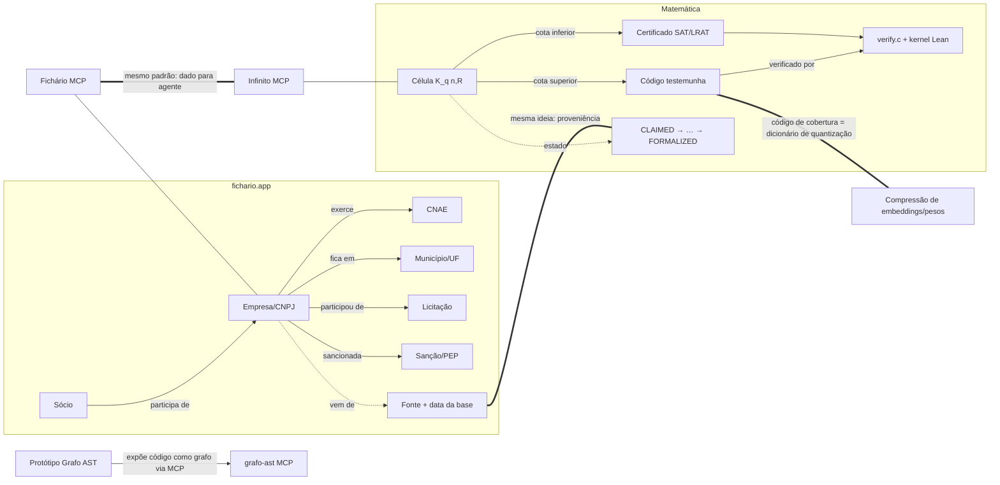

# Relatório: Fichário × Matemática × estado da arte

Data: 6 de novembro de 2026. Feito por 3 subagentes em paralelo. Os relatórios completos, com todas as URLs, estão em [`pesquisa/`](pesquisa/).

Legenda: **[V]** verificado em fonte primária, **[I]** inferência, **[?]** fonte secundária ou fontes que divergem.

---

## 1. O que cada coisa é de fato

| | **fichario.app** | **thiagopatzdorf/Matematica** |
|---|---|---|
| O que é | Consulta de CNPJ grátis, sem login, sobre os dados abertos da Receita Federal (28,4 mi de estabelecimentos ativos) [V] | Registro de cotas de **códigos de cobertura** `K_q(n,R)` verificado por máquina, com provas no Lean 4 [V] |
| MCP | "Fichário MCP", 14 ferramentas (CNPJ, lote, busca avançada, concorrentes, licitações, sanções/PEP, CVM, B3, publicações judiciais…) [V] | "Infinito": matemática, papers, computação pesada, Gemini; token por pessoa e teto de crédito em US$ [V] |
| Tese | Feito primeiro para agentes de IA: o mesmo dado em HTML, REST, MCP e llms.txt, sempre com a fonte [V] | "Achar é caro, verificar é barato; só conta o que a máquina confere" [V] |
| Autoria | Genesis Innovation; rodapé leva ao LinkedIn de Thiago Patzdorf [V] | thiagopatzdorf [V] → **provavelmente a mesma pessoa ou equipe** [I] |

**Correção importante de premissa.** O repositório Matemática **não** alega colapsar estruturas não polinomiais em polinomiais nem nada sobre P vs NP. O texto diz que P vs NP é "bússola de engenharia, não teorema" e que "não atacamos nenhum" dos Problemas do Milênio. Ali, "colapso de estado" é metáfora para a cota inferior e a superior se encontrarem, ou seja, o valor exato fica conhecido [V]. O agente conferiu três códigos com força bruta e eles cobrem o espaço inteiro; o trabalho é sério e honesto [V].

---

## 2. O grafo que liga os dois

As três arestas grossas são o cruzamento:

1. **Proveniência.** A ficha do Fichário guarda a fonte e a data da base. A célula do Matemática guarda o estado de evidência, calculado por script. É a mesma filosofia: um dado sem a sua origem não vale.
2. **MCP como produto.** Os dois expõem conhecimento para agentes, não só para pessoas. O Infinito traz o molde de governança (orçamento por pessoa, ações caras desligadas por padrão) que um MCP de dados pagos precisa.
3. **Código de cobertura e compressão.** Um código de cobertura de raio R é, literalmente, um dicionário de quantização vetorial no espaço de Hamming: toda palavra fica a no máximo R trocas de um representante. É o mesmo objeto que comprime embeddings (PQ/VQ, LSH binário) e pesos de redes neurais. É a ponte mais concreta entre a matemática pura do repositório e o deep learning.

---

## 3. Os conceitos em quatro níveis

### Espaço vetorial e "levantar" um problema

- **5 anos.** Arrumar brinquedos bagunçados é difícil. Se você der para cada brinquedo uma etiqueta com números (tamanho, cor, peso), dá para enfileirar e achar os parecidos muito rápido.
- **10 anos.** Duas bolinhas misturadas num papel não se separam com uma régua. Mas se você levantar uma delas do papel (acrescentar a altura), uma folha reta passa entre as duas. Ficou fácil porque você ganhou uma dimensão.
- **15 anos.** É o *kernel trick*: mapear os dados para um espaço maior onde o problema fica linear. O operador de Koopman faz isso com dinâmica (um sistema não linear vira linear num espaço de funções). A hierarquia de Lasserre faz com otimização polinomial (vira SDP, resolvido em tempo polinomial). O preço é que a dimensão cresce rápido.
- **Especialista.** Esse levantamento dá **relaxações**, não equivalências. Lasserre no nível *d* custa matrizes de ordem C(n+d, d), e só converge para o ótimo em nível finito sob hipóteses. Para problemas NP-difíceis, um nível fixo dá cota ou aproximação, nunca o ótimo em tempo polinomial (a menos que P = NP, que continua aberto [V]). O Matemática usa exatamente a versão honesta disso: as relaxações LP só servem para **certificar inviabilidade** (com Farkas inteiros), e a resposta exata vem de SAT com certificado.

### AST e grafo de código

- **5 anos.** Uma frase é feita de pedaços: quem faz, o que faz, com quê. Desenhar esses pedaços como galhos de uma árvore ajuda o computador a entender.
- **10 anos.** O computador transforma o programa numa árvore antes de rodar. Ligando as árvores de todos os arquivos ("esta função chama aquela"), vira um mapa de cidade: dá para ver quais ruas todo mundo usa.
- **15 anos.** AST é a árvore sintática abstrata. O grafo de chamadas mais o PageRank diz quais funções são centrais; é o que o Aider faz para escolher o que cabe no contexto de um LLM [V]. O cAST divide o código para RAG respeitando a árvore, sem cortar uma função no meio [V].
- **Especialista.** O *code property graph* (AST + fluxo de controle + dependência de dados) é a representação que dá melhores resultados em segurança. O LLMxCPG relata F1 de 15 a 40% melhor que os baselines, com consultas Joern geradas por LLM [V]. Resolver chamadas sem tipos (como o protótipo faz) é a principal fonte de erro.

### Compressão e aprendizado

- **5 anos.** Se você sabe que depois de "era uma" vem "vez", nem precisa escrever "vez". Quem adivinha melhor escreve menos.
- **10 anos.** Comprimir é achar o padrão e guardar só o que é surpresa. Um programa que acerta o próximo pedaço quase sempre gasta pouquíssimo espaço.
- **15 anos.** Prever bem e comprimir bem são a mesma coisa: codificação aritmética transforma qualquer previsor em compressor. O Chinchilla 70B comprime imagens para 43,4% (o PNG fica em 58,5%) sem nunca ter visto imagens no treino [V].
- **Especialista.** A capacidade dos modelos acompanha quase linearmente os bits por caractere (Pearson ≈ -0,95) [V]. Isso faz da compressão uma métrica de avaliação barata e sem rótulos. Do lado da eficiência: o BitNet b1.58 usa pesos ternários, e o NVFP4 perde cerca de 0,1% no MMLU [?]. O protótipo mostra a versão estrutural da mesma ideia: no pacote `json`, a árvore comprime 9,1x quando vira DAG, contra 3,7x do zlib no texto.

---

## 4. Potencial e valor

| Ativo | Valor hoje | Potencial | Risco |
|---|---|---|---|
| **Fichário** | Infraestrutura pública de dados empresariais pronta para agentes, com cobrança por máquina (x402) | Virar a "camada de verdade" de CNPJ para agentes de IA no Brasil: due diligence, KYC/KYB, prospecção, compliance | Dados derivados (site, faturamento estimado) podem errar; homônimos em processos judiciais e PEP; produto ainda pouco indexado |
| **Matemática** | Método de pesquisa reprodutível: LLM propõe, verificador exato decide, Lean formaliza | Exportar o **método** (escada de evidência + ledger) para outros domínios: fatoração já começou; dados empresariais também cabem | O valor acadêmico depende de confirmar a novidade das cotas inferiores; as 700 cotas no kernel são, na maioria, auditoria do que já estava publicado |
| **Protótipo Grafo AST** | Ferramenta MCP que funciona, sem dependências, com testes | Base para auditar sistemas legados e dar contexto de código a agentes | Só Python, resolução de chamadas por nome |

**A tese de valor combinada** [I]: os dois projetos já compartilham a filosofia de que só vale o que tem origem e verificação. Se o Fichário adotasse a escada de evidência do Matemática por campo (PROVADO = Receita Federal; VERIFICADO = conferido em segunda fonte; ESTIMADO = modelo; HIPÓTESE = achado automático), cada dado da ficha diria **quanto se pode confiar nele**, e um agente poderia decidir sozinho. Isso é raro e defensável.

---

## 5. Brasil: quão atrasado, em números

| Indicador | Brasil | Referência |
|---|---|---|
| P&D / PIB (2023) | **1,19%** | OCDE ≈ 2,7%; China 2,6%; EUA ≈ 3,4%; Coreia ≈ 5,0% [V] |
| Plano de IA (PBIA 2024-2028) | R$ 23 bi; execução declarada de "64%" em ago/2026 [?] | — |
| Supercomputação | Santos Dumont ≈ 18,85 PF desde jul/2025 [V]; máquina de Macaíba (RN) em edital [?] | ~90% da capacidade da América Latina [V] |
| Índice Global de Inovação 2026 | 53º de 139 [V] | Melhor posição: 49º (2023) |
| LLMs nacionais | Sabiá-3/4 (Maritaca) no nível do GPT-4o em exames do ENADE [V]; mais de 50 modelos em português [?] | — |

**Leitura honesta.** O Brasil gasta menos da metade da OCDE em P&D e cerca de 1/4 da Coreia. É líder **regional**, não global. O atraso maior está em capital (poucas rodadas grandes de investimento) e em computação, não em talento matemático: IMPA e OBMEP são de nível mundial.

---

## 6. Como conectar pessoas e sistemas: roteiro

Em ordem de esforço, cada passo usando o que já existe:

1. **Já feito:** protótipo `grafo-ast` (este diretório). O código vira grafo, vetores e medida de compressão, exposto via MCP.
2. **Próximo, pequeno:** adicionar tree-sitter ao protótipo para ler JS/TS, que é o que existe neste repositório (EasyPanel, Supabase, painel financeiro).
3. **Ponte Fichário ↔ Matemática:** um cliente que consulta o Fichário MCP e marca cada campo com a escada de evidência. Gravar no Supabase com pgvector: a empresa vira vetor (CNAE, região, porte) e "concorrentes" vira vizinhança k-NN.
4. **Grafo sócio–empresa:** detectar grupos econômicos por componentes e emparelhamento no grafo bipartido. É polinomial, ao contrário de procurar cliques gerais.
5. **Público:** servidores MCP para dados abertos brasileiros (IBGE, DOU, Transparência), seguindo a especificação MCP 2026-07-28. Ela não guarda estado entre chamadas, o que facilita hospedar.
6. **Matemática formal:** aproximar o método do Matemática de IMPA, IMPA Tech e OBMEP. É fronteira (AlphaProof, Aristotle, problemas de Erdős) que exige pouca computação, onde o Brasil é competitivo.

**O que não foi feito, de propósito:** criar empresas, contas, projetos em Supabase ou Vercel, ou chamar ferramentas pagas. São ações com custo e consequência jurídica; cada uma precisa de confirmação explícita.
